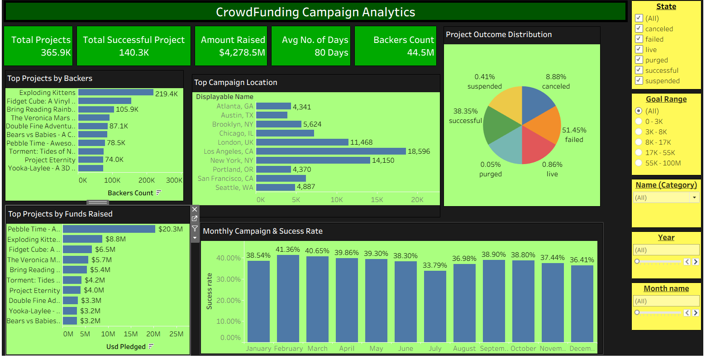

# Crowdfunding Campaign Analytics

## Project Overview
An interactive Tableau dashboard developed to analyze crowdfunding campaign performance, funding trends, project outcomes and geographical distribution.

## Key Analysis
- **Campaign Performance:** Analyzed total projects, successful projects, total funds raised, average campaign duration and backer count.
- **Project Outcomes:** Evaluated the distribution of successful, failed, canceled, live, suspended and purged campaigns.
- **Top Performing Projects:** Identified leading projects based on the number of backers and funds raised.
- **Geographical Analysis:** Examined campaign distribution and performance across different locations.
- **Monthly Trends:** Analyzed monthly campaign activity and success rates.

## Tools & Technologies
- Tableau
- Data Visualization
- Calculated Fields
- Interactive Filters
- KPI Analysis

## Dashboard Preview

## Key Skills Demonstrated
Data Analysis | Dashboard Development | KPI Tracking | Trend Analysis | Business Insights
